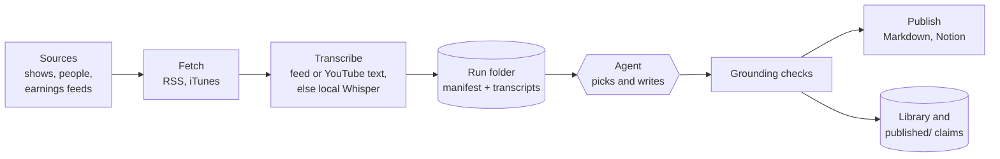

# podcast-alpha

Turns the week's investing podcasts into short, cited claims that an investor (or an investor's agent) can act on.

Every morning it pulls new episodes from about 40 shows and a watchlist of people, gets a transcript for the ones worth
reading, and hands them to an LLM agent that picks the three that matter and writes a report. Code then checks every
claim against the transcript (right episode, timestamp inside it, the cited number actually spoken there) before
anything is published. Weekly, the same pipeline ranks the whole week into a top-15 digest.

- **Free sources only.** RSS feeds, iTunes Search, YouTube captions and local Whisper. No paid APIs, no API keys.
- **No LLM calls in the code.** The judgment steps are prompts in [`prompts/`](prompts) that any agent can follow.
  Code does everything else and refuses output it cannot ground in a transcript.
- **Built to be queried.** Every claim lands in a searchable library and in [`published/`](published) as JSON, with
  the speaker, the timestamp and a link that jumps to that moment.



## Quickstart

Requires Python 3.10+ and `ffmpeg`.

```bash
git clone https://github.com/d3ming/podcast-alpha && cd podcast-alpha
python3 -m venv .venv
.venv/bin/pip install -e '.[dev,whisper]'        # on Apple silicon: '.[dev,whisper,mac]'
.venv/bin/podcast-alpha doctor                    # checks Python, Whisper, ffmpeg, network
.venv/bin/pytest -q
```

Start today's run. This fetches the last 48 hours and transcribes in the background:

```bash
.venv/bin/podcast-alpha today
.venv/bin/podcast-alpha status runs/$(date +%F)   # where the run stands and the exact next step
```

From there an agent follows [`prompts/daily.md`](prompts/daily.md): it loops on `status`, writes `selected.json` and
`report.json` when asked, and code validates, renders and publishes them.

## What you get

| Output | Where | What it is |
|---|---|---|
| Daily report | `runs/<date>/report.md`, Notion | Key insights, then three essential episodes with cited claims |
| Weekly digest | `runs/<week>/digest-*.md`, Notion | Top 15 episodes of the week, scored, with claims and links |
| Claims feed | [`published/<run>/claims.jsonl`](published) | Every claim: speaker, timestamp, tickers, deep link. Committed to git |
| Library | `data/library.sqlite` | Claims plus full-text transcript search: `podcast-alpha library query --ticker NVDA` |

An investor agent should start with [docs/agent-guide.md](docs/agent-guide.md).

## Configure

| File | Controls |
|---|---|
| [`sources.yaml`](sources.yaml) | Shows and feeds, each with a tier (1 is highest) and a preferred transcript source |
| [`people.yaml`](people.yaml) | People to search for across all podcasts (`core` people are always transcribed) |
| [`show_links.yaml`](show_links.yaml) | Each show's site, YouTube, Apple and Spotify links. Hand edits are never overwritten |
| [`publish.yaml`](publish.yaml) | Notion parent page for automatic publishing (with `NOTION_TOKEN`) |

## Documentation

- [Architecture](docs/architecture.md): how it works, where data lives, and why it is built this way.
- [Command reference](docs/reference.md): every command, flag and environment variable.
- [Agent guide](docs/agent-guide.md): querying the library and `published/` claims.
- [AGENTS.md](AGENTS.md): the operating manual for the agent that runs the pipeline.
- [Contributing](CONTRIBUTING.md): development setup, tests and commit style.

## Limits

Claims are checked against transcripts, not against filings or prices. Whisper does not label speakers, so speaker
names come from the agent. Video-only shows and YouTube captions need a residential IP address, because YouTube blocks
most data-center addresses.
