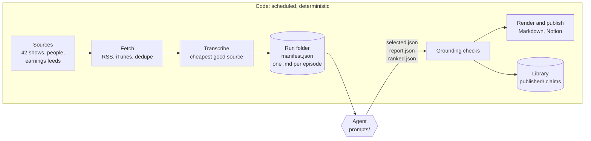
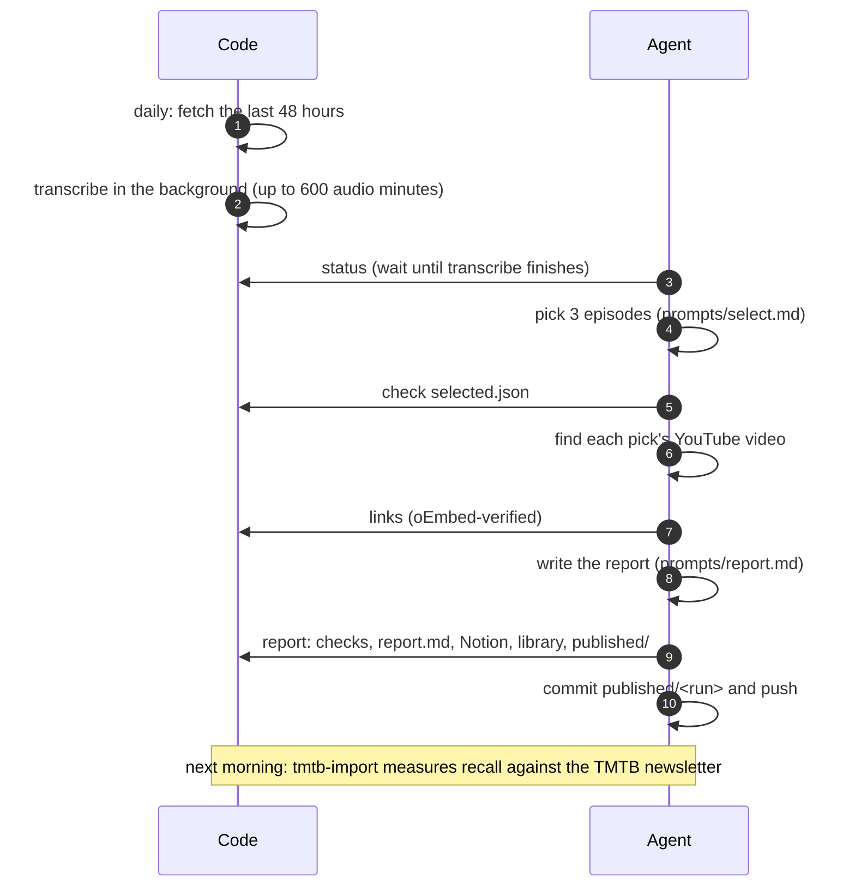

# Architecture

podcast-alpha splits the work in two. Deterministic code fetches, transcribes, checks and stores. An LLM agent makes
the two judgment calls: which episodes matter, and what they said. The agent's output is never trusted on its own;
code validates it against a JSON schema and grounds every claim in a transcript before anything is published.

## System overview

| Part | Module | Job |
|---|---|---|
| Fetch | `ingest.py`, `people.py`, `feedcache.py` | Read feeds and iTunes Search in parallel, drop reruns and out-of-window episodes, skip episodes already seen |
| Transcribe | `transcribe.py`, `whisper.py`, `triage.py` | Take the cheapest good transcript; whisper the rest in triage order within a budget |
| Run folder | `manifest.py` | One `manifest.json` per run, written only through a locked read-modify-write |
| Checks | `report.py`, `ranked.py` | Schema, episode ids, timestamps inside the transcript, numbers spoken near their timestamp, no long verbatim copying |
| Links | `links.py`, `showlinks.py` | Verified YouTube links, Apple episode pages, per-show links in `show_links.yaml` |
| Publish | `report.py`, `digest.py`, `notion.py`, `published.py` | Render Markdown, optionally create a Notion page, export `published/<run>/` |
| Library | `library.py` | SQLite with full-text search over claims and transcripts |
| Driver | `status.py`, `doctor.py`, `cli.py` | Tell the agent the next step; check the environment |

## Daily loop

The agent produces two files, `selected.json` and `report.json`. At every point `podcast-alpha status` names the next
step, so the agent never has to remember the order. Recall, the share of an outside newsletter's essential episodes
that our picks covered, is measured the next morning, once that newsletter has arrived.

The weekly path is the same shape at a larger scale. `rank-prep` splits about 40 transcripts into four batches, four
reader agents score them in parallel with `prompts/rank.md`, and `rank-merge` and `publish` dedupe, order, check and
render the top 15. See the [command reference](reference.md#run-a-week).

## Getting transcripts

Each episode takes the first source that works, cheapest first:

1. The feed's own transcript (`podcast:transcript` tag).
2. YouTube captions, when the episode is on YouTube.
3. A YouTube mirror: the same episode found by searching YouTube (residential IP only).
4. Local Whisper.

Whisper is the slow fallback, so `transcribe` first scores episodes on metadata (people watchlist, show tier, named
guests in the title, recency) and spends its audio-minute budget in that order. Every tier-1 show and every `core`
person is always included; the budget still caps the total.

## Mac and Linux

The code path is the same on both. Three things differ:

| | Apple silicon Mac | Linux server |
|---|---|---|
| Whisper | MLX `large-v3-turbo` on the GPU, picked automatically with the `mac` extra | faster-whisper `base.en` on the CPU |
| Speed on a 61-minute episode | 70 s (53x real time, M4 Max) | 97 s on the same Mac's CPU; a server CPU is likely slower |
| Transcript quality | Clearly better on company and product names | Garbles more names and phrases |
| YouTube captions and search | Work from a home IP address | Usually blocked; the run stops asking after the first block |

## Data

Nothing a run produces is in git except `published/`.

| What | Where | In git |
|---|---|---|
| Configuration | `sources.yaml`, `people.yaml`, `show_links.yaml`, `publish.yaml` | Yes |
| Agent instructions and output schemas | `prompts/`, `schema/` | Yes |
| Published outputs: agent JSON, Markdown, `episodes.json`, `claims.jsonl` | `published/<run>/` | Yes |
| Run folder: manifest, transcripts, logs | `runs/<name>/` | No |
| Seen-episode database, library, feed cache | `data/` | No |

Transcripts stay out of git because they are other people's full work. `published/` holds only our paraphrased claims
and public episode metadata, about 100-300 KB per run.

## Design decisions

- **No LLM calls in the code.** Any agent can run the prompts, the repo needs no model keys, and every mechanical step
  is testable. The cost is that the agent needs a runbook; `status` and `prompts/daily.md` are that runbook.
- **Check the agent, don't trust it.** Schemas plus grounding checks turn a hallucinated timestamp or a misquoted
  number into an error the agent must fix, instead of a published claim.
- **Free sources only.** Nothing to pay for or rotate. The trade-off is coverage: video-only shows need YouTube, and
  YouTube blocks most server IPs.
- **One manifest per run, locked writes.** `transcribe` runs for hours while `links`, `tmtb-import` and `status`
  update the same file, so every write goes through `manifest.update`.
- **Never guess a link.** A YouTube link needs oEmbed confirmation; an Apple episode link needs a guid or enclosure
  match, or a near-exact title within 2 days. No match means no link, not the closest one.
- **Human edits win.** `show_links.yaml` is filled automatically but never overwritten, so a correction sticks.
- **SQLite for the library.** No server to run, fast full-text search, and an agent can query it from a shell. It is
  local to one machine; `published/` covers agents elsewhere.

## Known limits

- Claims are checked against transcripts only, not against filings or prices.
- Whisper does not label speakers, so speaker names come from the agent.
- In the first weekly dogfood (week of October 17), 52 of 94 episodes had no transcript because Whisper was not
  installed on the machine that ran it.
